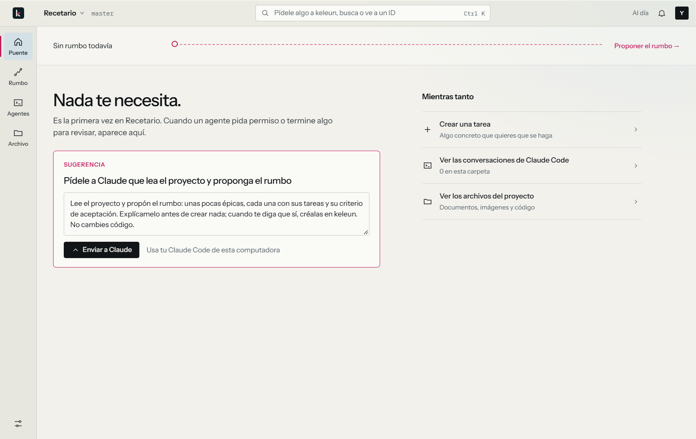

# keleun

App de escritorio para trabajar con **Claude Code** en tus proyectos sin perderte: ves en qué está trabajando el
agente, qué te necesita (permisos y trabajo para revisar), el rumbo del proyecto en épicas y tareas, y todo lo que se
hizo y por qué. Todo vive en tu computadora, dentro de la carpeta de tu proyecto.



## Descargar

**[Descargar keleun para Windows (última versión)](https://github.com/AudomaroDuran/keleun/releases/latest)** —
el archivo `keleun-<versión>-setup.exe` y la **guía de instalación en PDF**.

Versión beta para Windows 10 y 11 (64 bits).

## Instalar en 5 pasos

1. **Git**: descarga «Git for Windows» en [git-scm.com/download/win](https://git-scm.com/download/win) e instálalo con
   las opciones que trae.
2. **Claude Code**: en PowerShell pega `irm https://claude.ai/install.ps1 | iex`; luego abre una PowerShell nueva,
   escribe `claude` y entra con tu cuenta de Claude (plan Pro o Max).
3. **keleun**: abre `keleun-<versión>-setup.exe`. Si Windows muestra **«Windows protegió su PC»**, haz clic en
   **Más información › Ejecutar de todas formas** (la beta todavía no está firmada) y pulsa **Instalar**.
4. En keleun: **Elegir carpeta…** → tu proyecto → **Preparar con keleun**. No toca tu código: crea `docs/` y conecta
   Claude Code.
5. En el Puente: **Enviar a Claude** para que lea el proyecto y proponga el rumbo; si te gusta, contéstale «Sí,
   créalas».

La [guía completa (PDF)](docs/Guia-de-instalacion-keleun-0.9.6.pdf) explica cada paso con capturas, cómo revisar y
aprobar el trabajo del agente y los problemas comunes.

No hace falta instalar Node: keleun lo trae.

## Comprobar el instalador

El instalador todavía no tiene firma de código de Windows (por eso el aviso de SmartScreen). Puedes comprobar que es el
original de dos formas:

1. **Huella SHA-256** (lo más sencillo). En PowerShell, junto al instalador:

   ```
   Get-FileHash .\keleun-0.9.6-setup.exe
   ```

   El resultado debe ser igual al de `SHA256SUMS.txt` de la misma versión.

2. **Atestación firmada** (Sigstore). Cada instalador publicado que pasa la prueba en Windows limpio recibe una
   atestación firmada de GitHub que dice que ese archivo exacto lo verificó el flujo de este repositorio. Con
   [GitHub CLI](https://cli.github.com):

   ```
   gh attestation verify .\keleun-0.9.6-setup.exe --repo AudomaroDuran/keleun
   ```

   Las atestaciones se ven en [la página de atestaciones](https://github.com/AudomaroDuran/keleun/attestations).

## Probado en una Windows limpia

Cada versión publicada se instala en una máquina Windows nueva de GitHub Actions y se prueba de punta a punta sin Node:
instalación silenciosa, accesos directos, preparar un proyecto, conexión con Claude Code (hooks y servidor MCP),
registrar trabajo, verlo en vivo, una conversación con permiso aprobado en la app (con un Claude Code simulado: la
máquina de pruebas no tiene cuenta de Claude), cerrar sin procesos colgados y desinstalar. Ver la pestaña
[Actions](https://github.com/AudomaroDuran/keleun/actions) (flujo «UAT en Windows limpio») y `uat/uat-install.ts`.

## ¿Algo falló?

Abre un [issue](https://github.com/AudomaroDuran/keleun/issues) con qué hacías, qué esperabas y qué viste (una captura
ayuda mucho).

---

Este repositorio publica las versiones de keleun; el código fuente vive aparte.
